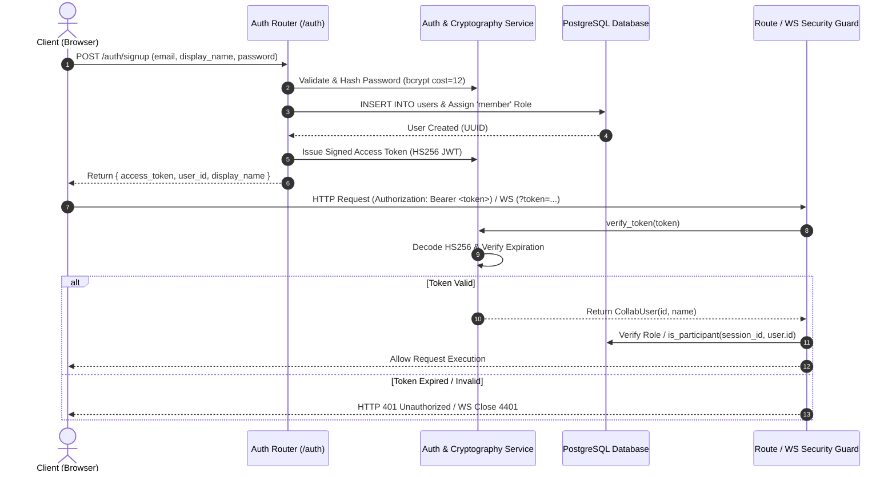
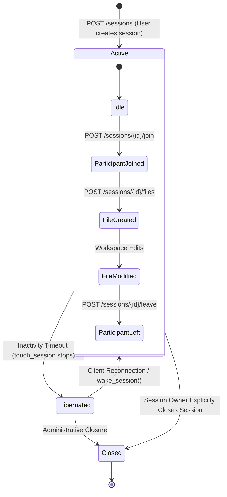
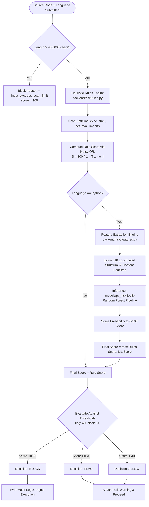
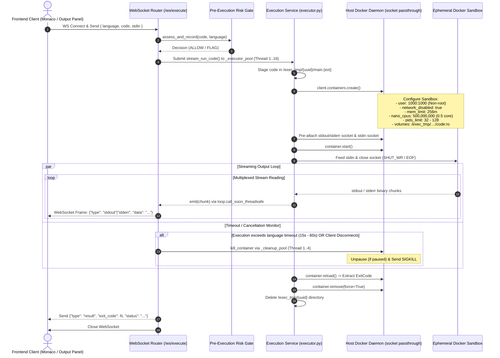
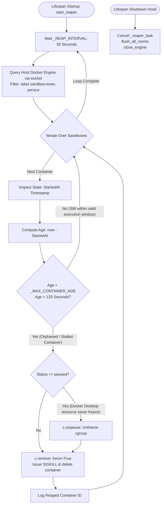

# Working Modules of GlassHouse

The **GlassHouse** platform is architecturally structured into **six core operational modules**. Each module possesses distinct responsibilities, isolates critical concerns (such as security, collaboration, and execution), and integrates with the overall system through well-defined APIs and protocols.

---

### Module 1: Authentication & Authorization Module

#### Description
The **Authentication & Authorization Module** governs user identity, access control, and credential management. It provides registration, credential verification, and JSON Web Token (JWT) issuance. It enforces Role-Based Access Control (RBAC) across system endpoints and validates session membership before allowing access to collaboration rooms and files.

#### Architectural Diagram



#### Explanation & Technical Details
* **Password Security**: Passwords are validated for length and byte size ($\le 72$ bytes to adhere to bcrypt specification) and hashed using `bcrypt` with unique salt generation via [`backend/app/auth.py`](file:///c:/Users/aryam/.vscode/Project/Secure-Collaborative-Sandboxed-Code-Execution-Platform/backend/app/auth.py).
* **Token Issuance & Verification**: Uses HMAC-SHA256 (`HS256`) JWTs containing the user UUID (`sub`), display name (`name`), and expiry timestamp (`exp`). Tokens default to an 8-hour lifetime (`COLLAB_JWT_EXPIRE_SECONDS = 28,800`). In production, secrets must be at least 32 characters long.
* **Dual Transport Injection**:
  * **HTTP**: Injected via FastAPI dependency `get_current_user` parsing the `Authorization: Bearer <token>` header.
  * **WebSocket**: Injected via `get_current_user_ws` extracting the token from query parameters (`?token=...`).
* **Sensitive Log Redaction**: The [`TokenRedactionFilter`](file:///c:/Users/aryam/.vscode/Project/Secure-Collaborative-Sandboxed-Code-Execution-Platform/backend/app/logging_filters.py) scrubs `?token=...` query parameters from Uvicorn access and application logs.

---

### Module 2: Session & Workspace Management Module

#### Description
The **Session & Workspace Management Module** allows users to organize multi-file software projects into distinct collaborative sessions. It tracks session lifecycle states (`active`, `hibernated`, `closed`), manages participant memberships, enforces hierarchical file paths, and prevents directory traversal attacks.

#### Architectural Diagram



#### Explanation & Technical Details
* **Session Lifecycles & State Tracking**: Implemented in [`collab_rooms.py`](file:///c:/Users/aryam/.vscode/Project/Secure-Collaborative-Sandboxed-Code-Execution-Platform/backend/app/routers/collab_rooms.py). Sessions are owned by an author UUID. When inactive, sessions transition to `hibernated`. When a participant rejoins, `wake_session()` automatically sets the status back to `active`. Closed sessions reject join operations with HTTP 409 Conflict.
* **Participant Scoping**: The table `session_participants` tracks join and leave timestamps. The function `is_participant()` verifies whether an actor is the session owner or an active participant with `left_at IS NULL`.
* **Path Sanitization & Normalization**: Implemented in [`collab_files.py`](file:///c:/Users/aryam/.vscode/Project/Secure-Collaborative-Sandboxed-Code-Execution-Platform/backend/app/routers/collab_files.py). File paths are strictly validated before entry into PostgreSQL:
  * Maximum 255 characters; no leading slashes.
  * Rejects null bytes (`\0`), backslashes (`\`), and directory traversal components (`..` or `.`).
  * Normalized via `posixpath.normpath`.
* **Cascading Cleanup on Deletion**: When an owner deletes a file (`DELETE /sessions/{id}/files/{fid}`), `close_room_for_file` immediately terminates all active WebSocket collaboration connections for that file (close code `4404`) and cancels snapshot timers, preventing resurrected in-memory state.

---

### Module 3: Real-Time Collaborative Code Editor Module (Yjs & CRDT)

#### Description
The **Real-Time Collaborative Code Editor Module** enables concurrent, multi-user document editing. It synchronizes text buffers using **Conflict-Free Replicated Data Types (CRDTs)** via the Yjs protocol, broadcasts collaborator cursor coordinates and text selections, and persists document snapshots to PostgreSQL.

#### Architectural Diagram

```mermaid
flowchart TD
    subgraph FrontendClients["Frontend Clients (React / Monaco)"]
        User1["Collaborator A\n(y-monaco + y-websocket)"]
        User2["Collaborator B\n(y-monaco + y-websocket)"]
    end

    subgraph CollabServer["Backend Collaboration Hub (ws_collab.py)"]
        WSHandler["WebSocket Router: /ws/collab/{s_id}:{f_id}"]
        RoomRegistry["_rooms Registry (guarded by asyncio.Lock)"]
        PyDoc["In-Memory pycrdt.Doc Instance"]
        AwarenessMap["Awareness Map (client_id -> clock, state)"]
        SnapLoop["Periodic Debounced Snapshot Task (Every 30s)"]
        EvictTimer["Idle Eviction Timer (60s)"]
    end

    subgraph DataStore["Persistence (PostgreSQL)"]
        FilesTable[("files table\n- yjs_state (BYTEA)\n- content (TEXT)")]
    end

    User1 <-->|Binary YMessageType.SYNC| WSHandler
    User2 <-->|Binary YMessageType.SYNC| WSHandler
    User1 <-->|Binary YMessageType.AWARENESS| WSHandler
    User2 <-->|Binary YMessageType.AWARENESS| WSHandler

    WSHandler <--> RoomRegistry
    RoomRegistry <--> PyDoc
    WSHandler <--> AwarenessMap

    PyDoc -->|doc.observe Event (dirty=True)| SnapLoop
    SnapLoop -->|DbStateStore.save| FilesTable
    WSHandler -->|Last Client Leaves| EvictTimer
    EvictTimer -->|On Expiry| FilesTable
```

#### Explanation & Technical Details
* **Wire Protocol & Frame Handling**: Implemented in [`ws_collab.py`](file:///c:/Users/aryam/.vscode/Project/Secure-Collaborative-Sandboxed-Code-Execution-Platform/backend/app/routers/ws_collab.py). Uses binary WebSocket messages conforming to the `y-websocket` specification:
  * `YMessageType.SYNC` (type 0): Carries state vectors and incremental updates processed via `pycrdt.handle_sync_message`.
  * `YMessageType.AWARENESS` (type 1): Carries JSON payloads encoding user names, cursor line/column offsets, and assigned selection colors.
* **Concurrency & Backpressure Controls**:
  * Each connected client is assigned a bounded outbound queue (`COLLAB_CLIENT_QUEUE_MAXSIZE = 256`).
  * If a client connection lags and the queue saturates, the client is marked as dropped and closed with code `1013` (Try Again Later) to avoid degrading room performance.
  * Room capacity is strictly capped at 20 concurrent clients (`COLLAB_MAX_ROOM_CLIENTS`).
* **Debounced Persistence (`DbStateStore`)**:
  * Active edits mark the room `dirty = True`.
  * A background loop runs every 30 seconds (`COLLAB_SNAPSHOT_INTERVAL`). If dirty, it serializes the binary CRDT update (`doc.get_update()`) and extracts the plain-text snapshot (`doc.get("content", type=Text)`), updating `files.yjs_state` and `files.content`.
  * When the room becomes empty, an eviction timer fires after 60 seconds of inactivity (`COLLAB_ROOM_IDLE_SECONDS`), flushes remaining state, and removes the room from RAM.

---

### Module 4: Pre-Execution Risk Analysis & Security Gate Module

#### Description
The **Pre-Execution Risk Analysis Module** functions as an automated security filter. Prior to container provisioning, submitted source code is evaluated to detect malicious actions, unauthorized system calls, evasion techniques, and exploit payloads. It pairs deterministic heuristic regular expression rules with a supervised machine learning classifier.

#### Architectural Diagram



#### Explanation & Technical Details
* **Layer 1: Rule-Based Heuristic Scorer**: Implemented in [`risk/rules.py`](file:///c:/Users/aryam/.vscode/Project/Secure-Collaborative-Sandboxed-Code-Execution-Platform/backend/risk/rules.py) and [`risk/scorer.py`](file:///c:/Users/aryam/.vscode/Project/Secure-Collaborative-Sandboxed-Code-Execution-Platform/backend/risk/scorer.py). Scans the input code against categorized threat signatures (file system access, shell execution, socket networking, dynamic reflection, and obfuscation). Rule weights ($0.0 \le w_i \le 0.99$) are combined using a **Noisy-OR** probability distribution:
  $$S = 100 \times \left(1 - \prod_{i=1}^n (1 - w_i)\right)$$
* **Layer 2: Machine Learning Risk Classifier**: Implemented in [`risk/engine.py`](file:///c:/Users/aryam/.vscode/Project/Secure-Collaborative-Sandboxed-Code-Execution-Platform/backend/risk/engine.py) and [`risk/features.py`](file:///c:/Users/aryam/.vscode/Project/Secure-Collaborative-Sandboxed-Code-Execution-Platform/backend/risk/features.py). For Python submissions, extracts an 18-dimensional feature vector:
  * Length & shape metrics: `log_lines`, `log_chars`, `log_max_line_len`, `mean_line_len`.
  * Obfuscation & entropy: Shannon entropy (`_entropy`), non-ASCII character ratios, hex escapes (`\xNN`), and long base64 runs.
  * Behavioral indicators: Call frequencies of `eval`/`exec`, `subprocess`/`os.system`, network libraries (`socket`, `requests`, `urllib`), and dynamic imports (`__import__`, `importlib`).
  * The pre-trained Random Forest model ([`models/py_risk.joblib`](file:///c:/Users/aryam/.vscode/Project/Secure-Collaborative-Sandboxed-Code-Execution-Platform/models/py_risk.joblib)) evaluates the vector, scaling the probability to a 0–100 score. The final risk score is calculated as:
  $$\text{Score}_{\text{final}} = \max(\text{Score}_{\text{rules}}, \text{Score}_{\text{ML}})$$
* **Defensive Policies**:
  * **Oversize Evasion Guard**: Inputs exceeding `MAX_SCAN_CHARS` (400,000 characters) are truncated for scanning and blocked with `input_exceeds_scan_limit`.
  * **Fail-Closed Protection**: If the risk engine crashes unexpectedly, `RISK_FAIL_CLOSED=True` forces a block decision with HTTP 503 (`risk_unavailable`).

---

### Module 5: Sandboxed Code Execution Engine Module

#### Description
The **Sandboxed Code Execution Engine Module** manages code execution within strictly isolated environments. It supports both synchronous execution (HTTP `POST /execute`) and real-time streaming output (WebSocket `/ws/execute`). It stages code into isolated directories, provisions language-specific Docker containers, configures OS-level containment mechanisms, demultiplexes standard output and error streams, and destroys containers immediately upon completion.

#### Architectural Diagram



#### Explanation & Technical Details
* **Container Sandboxing Parameters**: Implemented in [`executor.py`](file:///c:/Users/aryam/.vscode/Project/Secure-Collaborative-Sandboxed-Code-Execution-Platform/backend/app/services/executor.py). Each container runs with strict containment settings:
  * **Memory Limit**: `mem_limit="256m"` (hard cap at 256 MiB).
  * **CPU Quota**: `nano_cpus=500_000_000` (limits execution to 50% of a single CPU core).
  * **Process Limit**: `pids_limit` prevents fork bombs (32 for Python/Node/C/C++, 64 for Java/Rust, 128 for Go).
  * **File Size & Descriptors**: `ulimits` restrict file write size (`fsize` = 10 MB default, up to 256 MB for Go compiler artifacts) and open file descriptors (`nofile` = 2048).
  * **Network Isolation**: `network_disabled=True` disables all ingress and egress network traffic.
  * **User Privileges**: Runs as unprivileged non-root user `1000:1000` with `HOME=/tmp`.
  * **Filesystem Isolation**: The workspace is mounted as read-only (`mode="ro"`).
* **Multi-Language Runtime Support**:
  * Python (`python:3.12-slim`), JavaScript (`node:22-alpine`), Java (`eclipse-temurin:21-jdk`), C/C++ (`gcc:14`), Go (`golang:1.24-alpine`), and Rust (`rust:1.88-slim`).
* **Thread Pool Segregation**:
  * Worker tasks run in `_executor_pool` (16 threads).
  * Kill operations run in a dedicated `_cleanup_pool` (4 threads). This ensures that if the execution pool is saturated with long-running tasks, container termination requests can still be processed immediately.
* **Output Truncation**: Standard output and error streams are truncated if they exceed `MAX_OUTPUT_CHARS` (20,000 characters), notifying the client with `stdout_truncated` / `stderr_truncated` frames to protect network bandwidth and client-side rendering performance.

---

### Module 6: Container Reaper & Housekeeping Daemon Module

#### Description
The **Container Reaper & Housekeeping Daemon Module** runs in the background of the FastAPI application. It is responsible for garbage collection across the host Docker engine. It periodically inspects all platform-managed containers, identifies orphaned or stalled executions, unfreezes paused cgroups, and force-removes containers that have exceeded their allowable lifespan.

#### Architectural Diagram



#### Explanation & Technical Details
* **Orphan Detection & Reaping**: Implemented in [`reaper.py`](file:///c:/Users/aryam/.vscode/Project/Secure-Collaborative-Sandboxed-Code-Execution-Platform/backend/app/services/reaper.py). While the executor service normally destroys containers upon execution completion, edge cases such as process crashes, unexpected server restarts, or engine deadlocks can leak containers. The reaper task sweeps the engine every 30 seconds (`_REAP_INTERVAL = 30`).
* **Age Calculation**: Inspects the container attribute `State.StartedAt`. If the container has been running longer than `_MAX_CONTAINER_AGE = 120` seconds (twice the maximum language timeout of 60 seconds), it is flagged for removal.
* **Unpause Safeguard for Docker Desktop**: Docker Desktop on macOS and Windows includes resource-saver features that can automatically pause idle containers. Docker refuses to kill a paused container because its cgroup is frozen. The reaper detects this condition, unpauses the container, and forcefully removes it (`remove(force=True)`).
* **Non-Blocking Background Concurrency**: The reaper delegates container list and removal calls to `_cleanup_pool` via `loop.run_in_executor`, ensuring that Docker socket I/O operations do not block the main asynchronous event loop.
* **Application Lifecycle Integration**: Controlled within the FastAPI lifespan context manager in [`main.py`](file:///c:/Users/aryam/.vscode/Project/Secure-Collaborative-Sandboxed-Code-Execution-Platform/backend/app/main.py#L59-L106). It starts when the application boots and cleanly cancels during shutdown after flushing active Yjs collaboration rooms (`flush_all_rooms()`) and closing database connection pools (`close_engine()`).

---

### Summary Matrix of GlassHouse Modules

| Module # | Module Name | Primary Technologies | Implementation Locations | Key Responsibilities |
| :--- | :--- | :--- | :--- | :--- |
| **Module 1** | **Authentication & Authorization** | FastAPI, JWT (HS256), Bcrypt, PostgreSQL | `backend/app/auth.py`<br>`backend/app/routers/auth_router.py` | Credential registration, password hashing, JWT issue/validation, RBAC, query parameter token redacting. |
| **Module 2** | **Session & Workspace Management** | FastAPI, Pydantic, PostgreSQL, Posixpath | `backend/app/routers/collab_rooms.py`<br>`backend/app/routers/collab_files.py` | Project session lifecycle (active/hibernated/closed), membership checks, path traversal security, file CRUD. |
| **Module 3** | **Real-Time Collaboration** | PyCRDT, Yjs, WebSockets, Monaco Binding | `backend/app/routers/ws_collab.py`<br>`frontend/src/collaboration/provider.ts` | Conflict-free collaborative text editing, multi-user cursor awareness, debounced 30s DB flushes, 60s idle room eviction. |
| **Module 4** | **Pre-Execution Risk Analysis** | scikit-learn, Random Forest, Joblib, Regex | `backend/risk/analyzer.py`<br>`backend/risk/engine.py` | Dual-tier security scanning: Noisy-OR regex heuristic rules + 18-feature Python ML model, oversize guards, fail-closed enforcement. |
| **Module 5** | **Sandboxed Code Execution Engine** | Docker SDK, AsyncIO, Thread Pools | `backend/app/services/executor.py`<br>`backend/app/routers/ws_execute.py` | Ephemeral container sandboxing, read-only code mounting, process limits, network disabling, streaming I/O demuxing. |
| **Module 6** | **Container Reaper & Housekeeping** | Docker API, AsyncIO Tasks | `backend/app/services/reaper.py`<br>`backend/app/core/pools.py` | Background cleanup daemon, periodic 30s sweeping, stale container removal (>120s), cgroup unpausing, graceful server shutdown. |